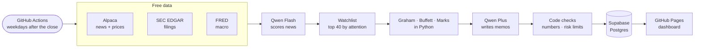

# AMIA: Autonomous Market Intelligence Analyst

**An AI equity analyst that runs itself in the cloud every trading day for about $6 a month.**

Every weekday after the US close, AMIA:
1. Reads about 1,500 market news items and new SEC filings, and builds a watchlist of the 40 stocks with real public traction.
2. Computes Graham, Buffett and Marks analysis for each one from point-in-time SEC filings.
3. Writes an investment memo with a decision for each stock, using a reasoning model.
4. Enforces risk limits in code, trades a paper portfolio and publishes the results.
5. Reviews its own mistakes once a month and turns repeated ones into permanent lessons.

Nobody runs it by hand. There's no server to maintain, and it never places real trades.

**[Live dashboard →](https://rhnld25.github.io/amia/)** &nbsp;·&nbsp; [Design spec](AMIA_spec_v2.2.md) &nbsp;·&nbsp; [Deploy your own](SETUP.md)

---

## What it costs to run

| What | Runs on | Per month |
|---|---|---:|
| Scheduled compute (about 12–30 min after each close, plus a monthly review) | GitHub Actions, free for public repos | **$0** |
| Database, online 24/7 | Supabase Postgres, free tier | **$0** |
| Public dashboard, online 24/7 | GitHub Pages | **$0** |
| News and daily prices for the whole US market | Alpaca Basic | **$0** |
| Company financials and filings | SEC EDGAR | **$0** |
| Interest rates, credit spreads, yield curve | FRED (St. Louis Fed) | **$0** |
| AI news scoring, about 1,500 items a day | Qwen 3.7 Flash via OpenRouter | **~$0.70** |
| AI investment memos and decisions, up to 40 a day | Qwen 3.7 Plus via OpenRouter | **~$5** |
| AI monthly post-mortems | Qwen 3.7 Plus via OpenRouter | **<$0.10** |
| **Total** | | **≈ $6, with a hard $10 cap in code** |

### Cost per unit

These numbers come from a live run on November 3, 2026, on real market data. They aren't estimates.

| Unit | Measured cost | Per dollar |
|---|---:|---:|
| Scoring one news item for novelty, sentiment and relevance | $0.00002 | ~50,000 items |
| One investment memo: reasoning over a ~3,200-token dossier, a thesis, three framework views, risks | $0.006 | ~170 memos |
| A full daily cycle: 40 memos, plus data, checks, portfolio and dashboard | ~$0.27 | |
| Daily run time with 4 memos written at once | 12 min | |

**How it stays this cheap:**
- **It only runs when there's work.** A scheduled job wakes up after the close, does the day's work and exits. Paying for an always-on server would be the expensive part, and AMIA doesn't need one.
- **Code does the math, the model does the judgment.** The Graham, Buffett and Marks numbers, the risk limits and the portfolio accounting are plain Python. The model is only asked the questions that need judgment.
- **A small model for volume, a stronger one for decisions.** News scoring is a short, structured task, so it goes to a very cheap model with reasoning turned off. Reasoning is only paid for on the 40 memos.
- **It only re-reviews what changed.** A stock is reviewed again only when it has new news, moves 5%, or hasn't been looked at in 5 days. Every day's decisions are made once and never repeated.
- **A hard budget in code.** Every AI call is logged with its billed cost. When the month reaches its cap, AMIA stops calling the model and alerts, instead of overspending.



---

## How it decides

No single rule decides whether to buy. The three frameworks are inputs, not gates.

| Input | What it measures |
|---|---|
| **News traction** | Attention that fades over about a week and is weighted by how relevant each item is. It picks which stocks get looked at. |
| **Graham** | 8 defensive criteria and an intrinsic value band, from filings as they were public on the decision date. |
| **Buffett** | Consistent ROE, low debt, durable margins, equity growth, and owner-earnings yield against the 10-year Treasury. |
| **Marks** | Market temperature from credit spreads, SPY trend and the yield curve. A stock-level pendulum from price position, momentum and coverage. |
| **Lessons** | Guidance from past post-mortems, given to the model for decisions in the same sector. |

The model weighs all of them and returns an action, an allocation, a calibrated confidence, a 3-point thesis, and a view from each of Graham, Buffett and Marks. Then code takes over:
- **Grounding:** every number in the thesis must appear in the data the model was given. A made-up figure blocks the buy.
- **Confidence bar:** the model must be at least 60% confident of beating SPY over six months, plus 5 points for each risk flag.
- **Hard limits:** 5% per position, 25% per sector, a portfolio beta cap, a correlation cap, and at most 3 new buys a day.
- **Snapshots:** everything the model saw is saved with each decision, under a content hash.

Performance is measured forward only, on live paper results: alpha against SPY, each position against its sector ETF, and cash against T-bills. The dashboard also tracks which inputs predict returns (rank IC) and how well calibrated the model's confidence is (Brier score).

## How a day runs

1. **News and filings.** It fetches all Alpaca news since the last run and drops roundups and items without high-impact keywords. It also picks up new EDGAR filings for watched companies.
2. **Fast-tier scoring.** Qwen 3.7 Flash scores each item 0–4 for novelty, sentiment and strategic relevance, running 8 calls in parallel.
3. **Watchlist.** It takes the top 40 names by attention. Held positions always stay on.
4. **Fills.** Yesterday's orders fill at today's open plus slippage, and every position is marked to the close.
5. **Framework math.** It computes Graham, Buffett, Marks, momentum, volatility and beta for every watchlist name.
6. **Memos.** Qwen 3.7 Plus reviews each name that needs it, 4 at a time.
7. **Code checks.** It checks the answer's format, number grounding, the confidence bar and the risk limits.
8. **Evaluation.** It updates the per-input IC and tags closed positions with likely causes.
9. **Dashboard.** It rebuilds the static page and publishes it to GitHub Pages.

On the 1st of each month, Qwen 3.7 Plus writes a post-mortem for each closed or missed trade. A lesson that at least 3 post-mortems agree on becomes permanent guidance.

## Local use

```bash
python3 -m venv .venv && .venv/bin/pip install -e ".[dev]"
```

Run the tests:

```bash
.venv/bin/python -m pytest -q
```

Replay 16 months on the synthetic market, with no keys needed:

```bash
AMIA_MOCK=1 .venv/bin/python -m amia simulate --start 2024-03-01 --end 2025-06-30
```

Render the dashboard to `./site`:

```bash
AMIA_MOCK=1 .venv/bin/python -m amia build-site
```

**Commands:** `daily [--date]`, `backfill [--days]`, `monthly`, `build-site`, `simulate` (mock only), `init-db`.

**Settings:**
- Without `DATABASE_URL`, the database is a local SQLite file, `amia_local.db`.
- Without `OPENROUTER_API_KEY`, or with `AMIA_MOCK=1`, a deterministic stand-in replaces the model.
- `AMIA_SCORING_MODEL` and `AMIA_DECISION_MODEL` take any OpenRouter model ID.

## Code map

| Path | What it does |
|---|---|
| `amia/data/` | EDGAR, FRED and Alpaca clients; SIC-to-sector map; synthetic `mock.py` for tests |
| `amia/discovery.py` | News noise filter, attention scores, the daily watchlist |
| `amia/frameworks/` | Graham (`graham.py`), Buffett (`buffett.py`), Marks (`marks.py`), all point-in-time |
| `amia/principles/` | The Graham, Buffett and Marks notes the model reads for judgment calls |
| `amia/rubrics/` | Versioned news and filing scoring rubric |
| `amia/llm.py` | OpenRouter calls: scoring, memos, post-mortems, spend tracking and the cap |
| `amia/decision.py` | Answer validation, number grounding, mock stand-in |
| `amia/risk.py` | Regime flags, required confidence, position, sector, beta and correlation limits |
| `amia/portfolio.py` | Fill model, daily marking, metrics against SPY and T-bills |
| `amia/evaluation.py` | Per-input rank IC, Brier score, attribution tags |
| `amia/learning.py` | Monthly post-mortems and permanent lessons |
| `amia/pipeline.py` | Daily orchestration |
| `amia/site.py` | Dashboard |

*Paper trading only. Nothing here is investment advice.*
